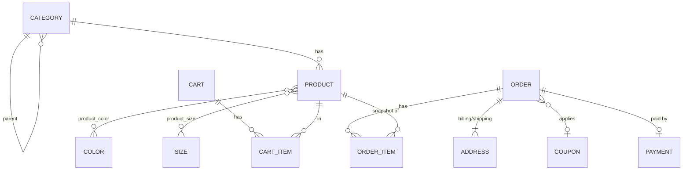

# 03 — Modelo de dados e migrações

Nível intermediário: entidades, relacionamentos e regras. Colunas exatas e índices finais ficam para o plano micro de cada entrega.

## Diagrama

Nomes de tabela em minúsculas e no plural: `categories`, `colors`, `sizes`, `products`, `product_color`, `product_size`, `carts`, `cart_items`, `orders`, `order_items`, `addresses`, `coupons`, `payments`. A tabela do pedido é `orders` (e não `order`, que é palavra reservada).

## Entidades

| Entidade | Papel | Campos principais |
|---|---|---|
| `Category` | Categoria, hierárquica | `name`, `image_url`, `parent_id` (nulo = raiz) |
| `Color` | Atributo de produto | `name` (único) |
| `Size` | Atributo de produto | `name` (único) |
| `Product` | Item do catálogo (evolui o atual) | `name`, `description`, `price`, `old_price` (nulo), `category_id`, `image_url`, `quantity`, `featured`, `created_at`, `popularity`, `rating` (nulo), `review_count` |
| `Cart` | Carrinho de um convidado | `token` (único), `status`, `customer_id` (nulo), `created_at`, `updated_at` |
| `CartItem` | Linha do carrinho | `cart_id`, `product_id`, `quantity`, `color_id` (nulo), `size_id` (nulo) |
| `Order` | Pedido | `number` (UUID público, único), `status`, `subtotal`, `discount`, `total`, `coupon_id` (nulo), `customer_id` (nulo), `created_at` |
| `OrderItem` | Linha do pedido, com snapshot | `order_id`, `product_id`, `product_name`, `unit_price`, `quantity`, `color_name` (nulo), `size_name` (nulo) |
| `Address` | Endereço do pedido | `order_id`, `type` (`BILLING`/`SHIPPING`), nome, sobrenome, e-mail, celular, linha 1, linha 2 (nula), país, cidade, estado, CEP |
| `Coupon` | Cupom de desconto | `code` (único), `type`, `value`, `valid_from`, `valid_until`, `max_uses`, `used_count`, `min_order_value`, `active` |
| `Payment` | Pagamento simulado | `order_id` (único), `method`, `status`, `amount`, `created_at` |

Campos do `Address` vêm do formulário do MultiShop (`checkout.html`). `rating` (`decimal(3,2)`, nulo) e `review_count` (`int`, padrão 0) existem no produto como **campos agregados somente leitura**, porque o card do shop exibe estrelas e a contagem. Não há módulo de avaliações (`Review` está fora do escopo): enquanto ele não existir, `rating` fica nulo e `review_count` fica 0, e a API ignora esses dois campos em `POST`/`PUT` de produto. Quando as avaliações entrarem, passam a ser recalculados por elas.

## Enums (`@Enumerated(EnumType.STRING)`)

| Enum | Valores |
|---|---|
| `CartStatus` | `OPEN`, `CONVERTED` |
| `OrderStatus` | `CREATED`, `PAID` |
| `AddressType` | `BILLING`, `SHIPPING` |
| `CouponType` | `PERCENTAGE`, `FIXED` |
| `PaymentMethod` | `PAYPAL`, `DIRECT_CHECK`, `BANK_TRANSFER` |
| `PaymentStatus` | `APPROVED` |

## Regras de modelo

- Produto → categoria é relacionamento (`category_id`), não string. A coluna `category` atual (`varchar(100)`) é migrada e removida.
- Cor e tamanho do produto são N:N simples (`product_color`, `product_size`), com PK composta. Estoque é único no produto.
- `CartItem` guarda a cor/tamanho **escolhidos**; unicidade lógica `(cart_id, product_id, color_id, size_id)` garantida no service (em MySQL, `NULL` em índice único não impede duplicatas).
- O carrinho **não** armazena preço. O preço vem do produto na hora da leitura.
- `OrderItem` congela nome, preço unitário, cor e tamanho no momento da compra.
- `Order.total = subtotal − discount`, nunca negativo. Sem frete.
- `Order.number` é gerado no servidor (UUID). Rotas públicas usam o número, não o id.
- `Address` pertence ao pedido (copiado do formulário). Sem entrega diferente, grava-se só o `BILLING` e o `SHIPPING` é opcional; o front trata a ausência como "mesmo endereço".
- `Payment.order_id` é único: um pedido tem no máximo um pagamento.
- `popularity` (proposta): unidades vendidas, incrementada na criação do pedido.
- `customer_id` em `Cart` e `Order` existe desde a primeira migration, sem FK por ora (não há tabela de clientes).
- Remoção: `cart_items` e `order_items` e `addresses` com `ON DELETE CASCADE` do pai. Remover produto referenciado por pedido é bloqueado (FK sem cascade).

## Regras de migração (skill `flyway-migrations`)

- **Somente SQL nativo.** Toda migration é um arquivo `.sql`. Migrations em Java (`BaseJavaMigration`, `JavaMigration`, inner classes ou qualquer classe de migração) são proibidas, inclusive para migração de dados: `UPDATE ... JOIN`, `INSERT ... SELECT` e afins resolvem em SQL.
- Local: `src/main/resources/db/migration`. Nome `V{N}__{Title_Case}.sql`, com a operação à frente (`Create_Table_`, `Alter_Table_`, `Insert_Data_In_`, `Populate_`).
- Versões sequenciais. **Nunca editar migration já aplicada.** DDL e DML em arquivos separados, DDL primeiro.
- Tipos MySQL: PK `bigint NOT NULL AUTO_INCREMENT`; FK com o mesmo tipo da coluna referenciada; `varchar(N)` com tamanho explícito; flag `bit(1)` (`b'1'`, `b'0'`); preço `decimal(65,2)`; data e hora `datetime(6)`; **sem display width** (`bigint`, `int`).
- `NOT NULL` em toda coluna que a entidade marca como `nullable = false`.
- Identificadores com crases. `CREATE TABLE IF NOT EXISTS`.
- `INSERT` com colunas explícitas.
- Tabelas de junção com PK composta.

## Plano de migrations por entrega

A numeração parte do estado atual (V1 e V2 aplicadas) e é indicativa; o plano micro de cada entrega a fixa.

| Entrega | Migrations (indicativas) |
|---|---|
| 1. Catálogo | V3 `Alter_Table_Products_Remove_Display_Widths` · V4 `Create_Table_Categories` · V5 `Create_Table_Colors_And_Sizes` · V6 `Alter_Table_Products_Add_Catalog_Columns` (`old_price`, `category_id`, `featured`, `created_at`, `popularity`, `rating`, `review_count`) · V7 `Create_Table_Product_Color_And_Size` · V8 `Populate_Categories_Colors_Sizes` · V9 `Populate_Products_Catalog` (migra a string `category` para `category_id` e remove a coluna antiga) |
| 3. Carrinho | `Create_Table_Carts` · `Create_Table_Cart_Items` |
| 5. Pedido | `Create_Table_Orders` · `Create_Table_Order_Items` · `Create_Table_Addresses` |
| 6. Cupom | `Create_Table_Coupons` · `Alter_Table_Orders_Add_Coupon` · `Populate_Coupons` (cupons de exemplo) |
| 7. Pagamento | `Create_Table_Payments` |

Observações:

- O `created_at` e o `popularity` dos produtos já existentes recebem valores determinísticos no seed; testes não podem depender de dados aleatórios.
- Em ordenações com empate, usar desempate por `id`.
- A migração da coluna `category` (string) para `category_id` é a única que mexe em dados existentes. Feita só em SQL (`INSERT ... SELECT DISTINCT` para criar as categorias a partir das strings e `UPDATE ... JOIN` para preencher `category_id`); reversível apenas por backup, não por migration.
